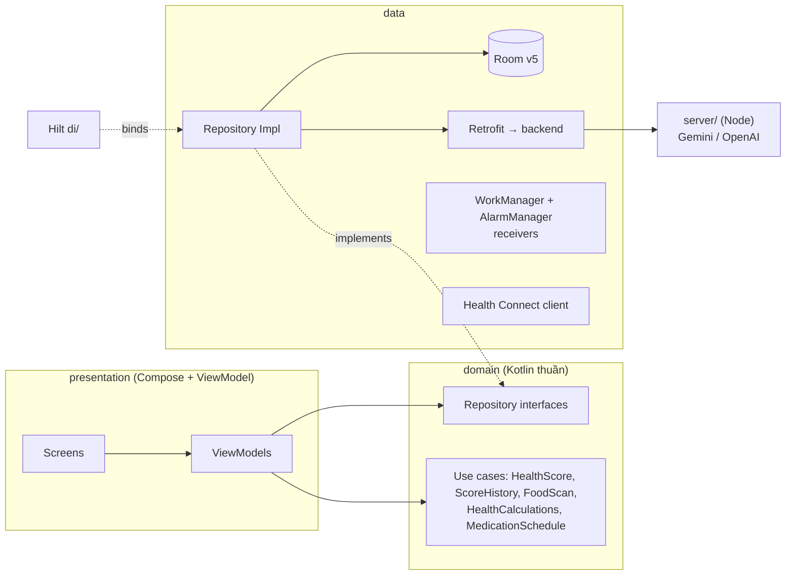
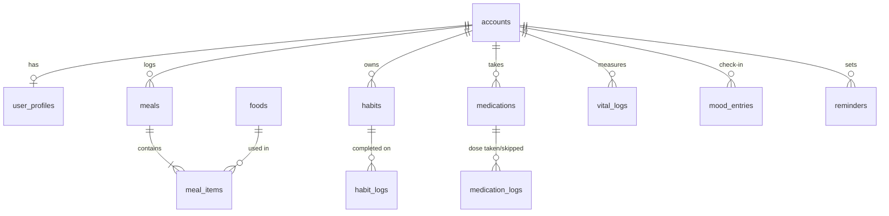

# Báo cáo kỹ thuật — AI Health & Habit Tracker

Ứng dụng Android theo dõi sức khỏe, thói quen và dinh dưỡng, hoạt động **offline-first** (dữ liệu lưu trên máy),
có ước tính dinh dưỡng từ ảnh món ăn bằng AI qua một backend nhỏ giữ khóa API.

## 1. Chức năng

| Nhóm | Chức năng | Điểm kỹ thuật |
|---|---|---|
| Lần đầu mở app | Onboarding 4 bước: hồ sơ, chỉ số cơ thể, mức vận động → gợi ý calo/macro, nước, BMI | Kiểm tra từng bước; người đã có hồ sơ được bỏ qua |
| Tổng quan | Điểm sức khỏe 0–100 có giải thích từng phần; **lịch sử 8 tuần + nhận xét so với tuần trước** | Công thức thuần Kotlin (`HealthScore`, `ScoreHistory`), cùng quy tắc cho mọi tuần, có unit test |
| Sức khỏe | Nhịp tim, huyết áp, đường huyết, cân nặng, giấc ngủ, bước chân; biểu đồ ngày/tuần/tháng | Biểu đồ vẽ bằng Compose `Canvas` |
| Health Connect | Nhập tự động (chỉ đọc), đồng bộ lại không trùng, ngắt kết nối có xóa dữ liệu | Quyền runtime, id tất định `hc_…`, fallback khi danh sách ưu tiên trống |
| Dinh dưỡng | Nhật ký bữa ăn, tra cứu Open Food Facts, **quét ảnh món ăn bằng AI** | Ảnh ≤1024 px, xóa EXIF/GPS, người dùng duyệt trước khi lưu |
| Thói quen, nước, tinh thần | Đánh dấu hằng ngày, mục tiêu nước, check-in cảm xúc, bài thở 4–4 | Room + ViewModel |
| Nhắc nhở & thuốc | Lịch nhắc theo giờ/ngày; lịch thuốc với nút "Đã uống/Bỏ qua" ngay trên thông báo; tỷ lệ tuân thủ 7 ngày | Thuốc: **báo thức chính xác** (`setExactAndAllowWhileIdle`, đúng phút cả khi Doze) + đặt lại sau khởi động/cập nhật/đổi giờ; không có quyền → WorkManager |
| Giao diện | Chế độ sáng/tối/theo máy | Bảng màu `HealthPalette` có bản tối, thanh hệ thống đổi theo |
| Ngôn ngữ | Tiếng Việt / English / theo máy, đổi ngay trong app | 608 chuỗi × 2 ngôn ngữ; per-app language (`LocaleManager`, `locales_config`); domain trả dữ liệu có cấu trúc, UI định dạng; ViewModel dùng `UiText`; backend nhận `lang` và trả mã lỗi `code` |
| Hình minh họa | Onboarding, trạng thái trống, màn hình giới thiệu tính năng | 13 `ImageVector` tự vẽ, màu lấy từ bảng màu (sáng/tối) lúc chạy; một nguồn `tools/illustrations/gen.py` sinh cả Kotlin và trang xem trước |
| Trợ năng | TalkBack, cỡ chữ lớn | Nhãn mô tả có tên mục, `Role` radio/checkbox, live region cho lỗi, vùng chạm ≥ 48 dp; chọn ảnh bằng Photo Picker hệ thống (không cần quyền bộ nhớ) |
| Dữ liệu | Xuất JSON qua bảng chia sẻ, xóa toàn bộ, dữ liệu mẫu cho demo | FileProvider, id `demo_…` để xóa riêng |

> Chi tiết từng thuật toán (công thức, lý do chọn, trường hợp biên, test): **[ALGORITHMS.md](ALGORITHMS.md)**.

## 2. Kiến trúc



- **presentation không import `data`** (kiểm tra được bằng `grep`); ViewModel chỉ phụ thuộc interface domain.
- **domain không có lớp Android** → test JVM nhanh, không cần thiết bị.
- Khóa API **chỉ ở server** (`server/.env`), không nằm trong APK.

## 3. Cơ sở dữ liệu (Room, phiên bản 6)



Ngoài ra: `water_logs`, `sleep_logs`, `activity_logs`, `weight_logs`. Lịch sử migration 1→6 đều có
`Migration` tường minh; schema xuất ra `app/schemas/` và được kiểm thử bằng `MigrationTestHelper`.
Migration 4→5 chuyển check-in cảm xúc từ SharedPreferences sang Room (dữ liệu cũ được nhập tự động) và bỏ bảng không dùng.

## 4. Luồng quét ảnh món ăn

```mermaid
sequenceDiagram
  actor U as Người dùng
  participant A as App (ViewModel)
  participant E as ImageEncoder
  participant S as Backend (server/)
  participant M as Gemini / OpenAI
  U->>A: Chụp/chọn ảnh
  A->>E: thu nhỏ ≤1024px, xoay EXIF, JPEG (bỏ GPS)
  A->>S: POST /api/food-image (base64)
  S->>M: ảnh + JSON schema bắt buộc + danh sách khóa bảng dinh dưỡng
  M-->>S: món, gram, khóa bảng (table_key), kcal, P/C/F, độ tin cậy
  S->>S: kiểm tra & giới hạn giá trị; khớp bảng → kcal/macro = giá trị/100 g × gram; 429 → model dự phòng
  S-->>A: kết quả (+ model đã dùng)
  A->>U: duyệt: sửa gram (tự tính lại), bỏ món, nhãn "theo bảng"/"AI ước tính", cảnh báo calo≠macro
  U->>A: Lưu vào nhật ký
```

## 5. Đánh giá độ chính xác AI

Bộ ảnh **Nutrition5k** (Google Research, CC BY 4.0): món ăn được **cân trong phòng thí nghiệm**, chụp từ trên xuống.
Script: `server/eval-food.mjs`, chọn ảnh: `server/eval/prepare-nutrition5k.mjs` (bộ phát triển và bộ holdout riêng).

| Model | Ảnh | Sai số calo trung vị | Sai số trung bình | Trong ±20% | Thời gian |
|---|---|---|---|---|---|
| gemini-3.5-flash (gói miễn phí) | 15 | **16,5%** | 21,1% | 10/15 | ~8 s |

- Nhận diện món tốt; sai nhiều nhất ở **thực phẩm giàu năng lượng** (hạt, xúc xích) và khẩu phần lớn.
- Hạn chế: mẫu nhỏ; món Âu/Mỹ chứ không phải món Việt; kết quả AI dao động giữa các lần chạy.
  → Ứng dụng luôn cho người dùng **sửa trước khi lưu** và hiển thị độ tin cậy.

**Thử nghiệm: calo từ bảng dinh dưỡng thay vì để AI tự đoán** (bộ holdout, cùng một lần gọi AI cho cả hai cách → so sánh cặp):

| Cách tính calo | Ảnh có kết quả | Sai số trung vị | Sai số trung bình | Lệch trung bình | Trong ±20% |
|---|---|---|---|---|---|
| AI tự đoán calo | 10/15 | 19,8% | 21,9% | −16,4% | 6/10 |
| Bảng dinh dưỡng × gram AI ước tính | 10/15 | 19,9% | 21,4% | −17,0% | 6/10 |

- 31/31 món được khớp vào bảng. 5 ảnh lỗi do dịch vụ miễn phí (3 quá thời gian 45 s, 2 lỗi 503), không phải do bảng.
- **Kết luận trung thực: bảng không làm giảm sai số trên bộ ảnh này.** Với món Âu/Mỹ phổ biến, calo/100 g mà model tự đưa ra đã gần như trùng USDA;
  sai số còn lại gần như hoàn toàn đến từ **ước lượng khối lượng** (gram lệch trung bình −12%, sai số tuyệt đối 17,7%) — nhất là hạt hạnh nhân và đĩa nhiều món.
- Vẫn giữ cách tính theo bảng vì: số liệu **truy được nguồn** và nhất quán giữa các lần chạy, mỗi món ghi rõ nguồn calo, và có chỗ cho món Việt
  (nơi model kém chắc chắn hơn) — nhưng lợi ích cho món Việt **chưa được đo**.
- Hướng cải thiện có ích nhất tiếp theo là ước lượng gram (vật tham chiếu kích thước, ảnh nghiêng, hoặc cho người dùng chọn cỡ khẩu phần).

Dữ liệu: bảng sinh bởi `server/eval/build-food-table.mjs` từ thành phần nguyên liệu của Nutrition5k (giá trị theo USDA; đã loại 30 món dùng để đánh giá)
và `server/data/vn-foods.json` (món Việt, giá trị xấp xỉ). Lưu ý: số liệu chuẩn của Nutrition5k cũng dựa trên USDA, nên phép đo này chủ yếu đo sai số nhận diện + gram.

## 6. Kiểm thử

| Loại | Số test | Nội dung |
|---|---|---|
| JVM unit | 104 | Điểm sức khỏe + **lịch sử tuần & nhận xét**, BMI châu Á, TDEE, lịch nhắc/thuốc, tuân thủ, quét ảnh (nguồn calo), Health Connect mapping, **ViewModel** (Profile, Mental, Reports + xuất PDF) với fake repository, **tìm món không dấu** + thư viện món Việt khớp bảng của backend, **cảnh báo sinh hiệu** (nghỉ/vận động, huyết áp, chống lặp) + kịch bản đồng hồ mô phỏng |
| Instrumented (emulator) | 11 | Migration 4→5 + chuỗi 1→5, hồi quy bữa ăn (Room), tìm "pho bo" offline ra "Phở bò", nhập dữ liệu cảm xúc cũ, **Compose UI** (điểm sức khỏe, biểu đồ tuần) — chạy đạt ở cả tiếng Việt và tiếng Anh |
| Backend | 18 | Endpoint, xác thực đầu vào, JSON schema, Gemini/OpenAI, model dự phòng, chế độ giả lập, **bảng dinh dưỡng** (khớp/không khớp, độ hợp lý từng dòng), ngôn ngữ trả lời, mã lỗi |
| Lint | 0 lỗi | `./gradlew :app:lintDebug` |

CI (GitHub Actions) chạy unit test, Lint, build APK và test backend mỗi lần push.

Kiểm thử thủ công trên emulator (Android 17): báo thức thuốc kêu đúng 00:31:00 rồi tự đặt lịch hôm sau; khởi động lại emulator → `MedicationBootReceiver` đặt lại cả hai báo thức (`dumpsys alarm`); xóa thuốc → báo thức bị hủy.

## 7. Bảo mật & quyền riêng tư

- Dữ liệu sức khỏe chỉ lưu trên máy; **tắt sao lưu tự động**; xuất dữ liệu có cảnh báo.
- Khóa AI chỉ ở server; repo công khai đã được quét, không có khóa/thông tin cá nhân.
- Ảnh gửi đi đã xóa EXIF/GPS; gói miễn phí của Gemini có thể dùng dữ liệu để cải thiện model → không dùng cho ảnh nhạy cảm.
- R8 keep rules cho lớp Gson (tránh lỗi bản release đổi tên trường JSON).

## 8. Hạn chế & hướng phát triển

- Không có đăng nhập (ứng dụng một người dùng, offline) — có chủ đích; đồng bộ nhiều thiết bị cần backend có xác thực.
- Cơ sở dữ liệu trên máy chưa mã hóa (SQLCipher); backend chỉ chạy cục bộ (cần HTTPS khi triển khai thật).
- Nhắc nhở thói quen/nước vẫn dùng WorkManager (có thể trễ khi Doze); chỉ lịch thuốc dùng báo thức chính xác.
- Thanh tab giữ cỡ chữ chuẩn khi phóng to chữ để không bị cắt.
- Bảng món Việt (`server/data/vn-foods.json`) là giá trị **xấp xỉ** theo công thức phổ biến, chưa đối chiếu từng món với Bảng thành phần thực phẩm Việt Nam; chưa có bộ ảnh món Việt được cân để đánh giá.
