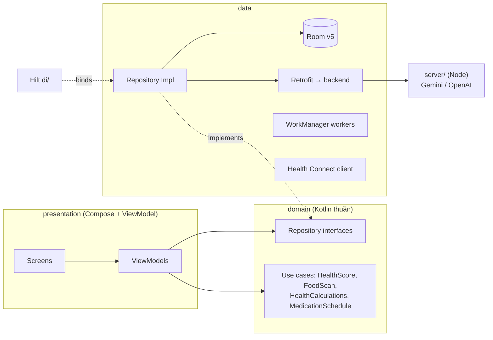
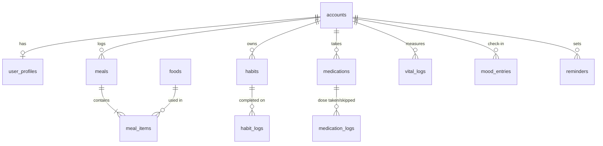

# Báo cáo kỹ thuật — AI Health & Habit Tracker

Ứng dụng Android theo dõi sức khỏe, thói quen và dinh dưỡng, hoạt động **offline-first** (dữ liệu lưu trên máy),
có ước tính dinh dưỡng từ ảnh món ăn bằng AI qua một backend nhỏ giữ khóa API.

## 1. Chức năng

| Nhóm | Chức năng | Điểm kỹ thuật |
|---|---|---|
| Tổng quan | Điểm sức khỏe 0–100 có giải thích từng phần | Công thức thuần Kotlin, theo khuyến nghị công khai, có unit test |
| Sức khỏe | Nhịp tim, huyết áp, đường huyết, cân nặng, giấc ngủ, bước chân; biểu đồ ngày/tuần/tháng | Biểu đồ vẽ bằng Compose `Canvas` |
| Health Connect | Nhập tự động (chỉ đọc), đồng bộ lại không trùng, ngắt kết nối có xóa dữ liệu | Quyền runtime, id tất định `hc_…`, fallback khi danh sách ưu tiên trống |
| Dinh dưỡng | Nhật ký bữa ăn, tra cứu Open Food Facts, **quét ảnh món ăn bằng AI** | Ảnh ≤1024 px, xóa EXIF/GPS, người dùng duyệt trước khi lưu |
| Thói quen, nước, tinh thần | Đánh dấu hằng ngày, mục tiêu nước, check-in cảm xúc, bài thở 4–4 | Room + ViewModel |
| Nhắc nhở & thuốc | Lịch nhắc theo giờ/ngày; lịch thuốc với nút "Đã uống/Bỏ qua" ngay trên thông báo; tỷ lệ tuân thủ 7 ngày | WorkManager, BroadcastReceiver, `goAsync()` |
| Dữ liệu | Xuất JSON qua bảng chia sẻ, xóa toàn bộ, dữ liệu mẫu cho demo | FileProvider, id `demo_…` để xóa riêng |

## 2. Kiến trúc



- **presentation không import `data`** (kiểm tra được bằng `grep`); ViewModel chỉ phụ thuộc interface domain.
- **domain không có lớp Android** → test JVM nhanh, không cần thiết bị.
- Khóa API **chỉ ở server** (`server/.env`), không nằm trong APK.

## 3. Cơ sở dữ liệu (Room, phiên bản 5)



Ngoài ra: `water_logs`, `sleep_logs`, `activity_logs`, `weight_logs`. Lịch sử migration 1→5 đều có
`Migration` tường minh; schema xuất ra `app/schemas/` và được kiểm thử bằng `MigrationTestHelper`.
Migration 4→5 chuyển check-in cảm xúc từ SharedPreferences sang Room (dữ liệu cũ được nhập tự động) và bỏ bảng không dùng.

## 4. Luồng quét ảnh món ăn

```mermaid
sequenceDiagram
  actor U as Người dùng
  participant A as App (ViewModel)
  participant E as ImageEncoder
  participant S as Backend (server/)
  participant M as Gemini / OpenAI
  U->>A: Chụp/chọn ảnh
  A->>E: thu nhỏ ≤1024px, xoay EXIF, JPEG (bỏ GPS)
  A->>S: POST /api/food-image (base64)
  S->>M: ảnh + JSON schema bắt buộc
  M-->>S: món, gram, kcal, P/C/F, độ tin cậy
  S->>S: kiểm tra & giới hạn giá trị; 429 → thử model dự phòng
  S-->>A: kết quả (+ model đã dùng)
  A->>U: duyệt: sửa gram (tự tính lại), bỏ món, cảnh báo calo≠macro
  U->>A: Lưu vào nhật ký
```

## 5. Đánh giá độ chính xác AI

Bộ ảnh **Nutrition5k** (Google Research, CC BY 4.0): món ăn được **cân trong phòng thí nghiệm**, chụp từ trên xuống.
Script: `server/eval-food.mjs`, chọn ảnh: `server/eval/prepare-nutrition5k.mjs` (bộ phát triển và bộ holdout riêng).

| Model | Ảnh | Sai số calo trung vị | Sai số trung bình | Trong ±20% | Thời gian |
|---|---|---|---|---|---|
| gemini-3.5-flash (gói miễn phí) | 15 | **16,5%** | 21,1% | 10/15 | ~8 s |

- Nhận diện món tốt; sai nhiều nhất ở **thực phẩm giàu năng lượng** (hạt, xúc xích) và khẩu phần lớn.
- Hạn chế: mẫu nhỏ; món Âu/Mỹ chứ không phải món Việt; kết quả AI dao động giữa các lần chạy.
  → Ứng dụng luôn cho người dùng **sửa trước khi lưu** và hiển thị độ tin cậy.

## 6. Kiểm thử

| Loại | Số test | Nội dung |
|---|---|---|
| JVM unit | 48 | Điểm sức khỏe, BMI châu Á, TDEE, lịch nhắc/thuốc, tuân thủ, quét ảnh, Health Connect mapping, **ViewModel** (Profile, Mental, Reports) với fake repository |
| Instrumented (emulator) | 6 | Migration 4→5 + chuỗi 1→5, hồi quy bữa ăn (Room), nhập dữ liệu cảm xúc cũ, **Compose UI** |
| Backend | 13 | Endpoint, xác thực đầu vào, JSON schema, Gemini/OpenAI, model dự phòng, chế độ giả lập |
| Lint | 0 lỗi | `./gradlew :app:lintDebug` |

CI (GitHub Actions) chạy unit test, Lint, build APK và test backend mỗi lần push.

## 7. Bảo mật & quyền riêng tư

- Dữ liệu sức khỏe chỉ lưu trên máy; **tắt sao lưu tự động**; xuất dữ liệu có cảnh báo.
- Khóa AI chỉ ở server; repo công khai đã được quét, không có khóa/thông tin cá nhân.
- Ảnh gửi đi đã xóa EXIF/GPS; gói miễn phí của Gemini có thể dùng dữ liệu để cải thiện model → không dùng cho ảnh nhạy cảm.
- R8 keep rules cho lớp Gson (tránh lỗi bản release đổi tên trường JSON).

## 8. Hạn chế & hướng phát triển

- Không có đăng nhập (ứng dụng một người dùng, offline) — có chủ đích; đồng bộ nhiều thiết bị cần backend có xác thực.
- Cơ sở dữ liệu trên máy chưa mã hóa (SQLCipher); backend chỉ chạy cục bộ (cần HTTPS khi triển khai thật).
- Nhắc nhở dùng WorkManager (không chính xác tuyệt đối khi Doze); thuốc quan trọng nên dùng `AlarmManager.setExactAndAllowWhileIdle`.
- Văn bản giao diện còn viết trực tiếp trong code (chưa đưa vào `strings.xml` để đa ngôn ngữ).
- AI: dùng bảng thành phần dinh dưỡng Việt Nam để tính calo từ món + gram (thay vì để AI tự đoán calo); đánh giá trên món Việt.
